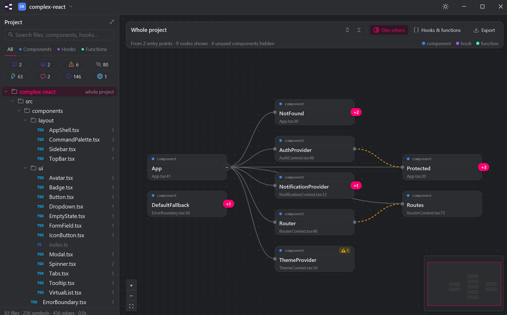

# Rendermap

**Website: [dalladirosa.github.io/react-graph](https://dalladirosa.github.io/react-graph/)** · Formerly called React Graph.

A fast desktop app that maps a React codebase as an interactive graph of **components**, **hooks** and **functions**, with a Project panel inspired by JetBrains IDEs. It runs on **Windows** and **macOS (Apple Silicon)**.

Open a folder of `.ts` / `.tsx` / `.js` / `.jsx` files and Rendermap parses it with tree-sitter (it never runs your code). It shows what renders, calls and passes what, starting from your entry points.



## Features

- **Graph view.** Components, hooks and functions are shown as cards, with edges for render, call and prop relations. Expand or collapse nodes (one by one, or all at once with the two arrow buttons in the toolbar), use **Dim others** to focus on one, zoom, and pan with the minimap.
- **Context links.** A component that provides a context (`<ThemeContext.Provider>`) is linked, with a dashed amber edge (solid when zoomed far out), to everything that reads it: `useContext(ThemeContext)`, and the components and hooks that call a custom hook doing so.
- **Next.js.** App Router (`app/`) and Pages Router (`pages/`) projects are recognised. `page`, `layout`, `loading`, `error`, `not-found`, `route` and `_app` files are marked as entry points with their URL (`/blog/[slug]`; route groups and slots don't count), are never reported as unused, and each page and layout hangs off the nearest layout above it. Components get a `server` / `client` badge: Server Components by default, client with `"use client"` or when a client component renders them, and Server Actions with `"use server"`. A Server Component that calls `useState`, `useEffect` and the like, or puts `onClick` on an element, gets a warning.
- **Path aliases.** `paths` and `baseUrl` from `tsconfig.json` / `jsconfig.json` (including `extends`) are followed, so `import { Button } from "@/ui/Button"` resolves like a relative import. Without a config, `@/` and `~/` are assumed to mean `src/`.
- **Live reload.** The graph rebuilds when a source file or tsconfig in the open folder changes. Selection, expanded cards and the view stay where they are.
- **Project panel.** A file tree with symbol counts. Search by typing anywhere, and use the tabs to show only components, hooks or functions (Ctrl+click, or ⌘-click on a Mac, combines kinds).
- **Code-health filters.** Each filter shows how many symbols match:
  - **Duplicates:** similar code exists elsewhere (structural fingerprints, so renamed copies still match)
  - **Identical:** an exact structural twin exists, where only names or literals differ
  - **Warnings:** hook dependency problems, and props that defeat a `memo` child (an inline `{}`, `[]` or `() => …`, or a value built in the render body, passed to a component wrapped in `memo`), and **prop drilling** (a prop that two or more components only hand on to a child, without reading it, before something finally uses it; the hint names the whole route), `lazy()` components rendered with no `<Suspense>` above them, and route pages with no error boundary (no `errorElement` on the route or its parents, and no `ErrorBoundary` around the page). Components loaded with `lazy(() => import(...))` get a `lazy` badge. A component that renders its `children` inside a `<Suspense>` or an `ErrorBoundary` covers what is passed to it, and a router (`Routes`, `RouterProvider`, `Outlet`) shown inside one covers its pages. A boundary around `render(<App />)`, outside any component, can't be seen. Four rules of React are checked too: hooks called conditionally, in a loop, in a callback, after an early return or outside a component or hook; effects that add a listener, interval, subscription or WebSocket but return no cleanup; state an effect only derives from other values (compute it while rendering instead); and `.map()` list items without a `key`.
  - **Unused:** nothing renders, calls or passes it
  - **Memoized:** wrapped in `memo`, `useCallback` or `useMemo`
  - **Cycles:** components or functions that render or call each other in a loop (A → B → A). Self-recursion doesn't count.
  - **No tests:** no test file imports it. Test files are `*.test.*`, `*.spec.*` and anything in a `__tests__` folder; imports through barrels and path aliases count, and `import * as x` covers the whole file. Only top-level symbols are flagged, and the filter stays empty in a project with no tests. Select a symbol to see the tests that import it under **Tests**, and click one to open it in your editor.

  - **Data:** calls out to an API (`fetch`, `axios.get(...)`), a data-fetching hook (`useQuery`, `useSWR`, `useMutation`) or a store (redux, zustand `use...Store`, jotai, recoil) itself. Cards get a `data` badge, and the detail panel lists each call with its method and path (`POST /api/orders/{}`), including those made by the hooks and functions the symbol calls ("via useTodos"). Detected by well-known names only.
- **Changes.** In a git repository, the graph is compared with the last commit (HEAD). New cards get a green border and a `new` badge, edited ones a blue border and an `edited` badge, and unchanged cards that use one of them a dashed blue border (where the change may show). A removed symbol is drawn as a faded, dashed red card after the open card that used it, and a link that is gone is drawn as a dashed red line. The **Changes** strip under the filters counts new, edited and removed symbols, plus the problems your uncommitted edits brought in (`⚠`) or fixed (`✓`): new or extra warnings, a component nothing uses any more, a new render/call loop, new code no test imports. Click it to show only what changed, with those problems and the removed symbols listed above. Select a card to see which links it gained or lost ("now renders Streak", "no longer renders MyTasks"). It updates when you save a file and when you commit or switch branches. Needs the `git` command on your PATH.
- **Compare.** Shows two similar symbols side by side, with the differing tokens highlighted.
- **Play flow.** Animates a trace from any symbol, either level by level ("waves") or in call-and-return order, and can also show it as a sequence diagram.
- **Path finder.** Right-click a card and choose **Find path from here…**, then right-click another card and choose **Find path to here**. The shortest chain of renders and calls between them is drawn, lit up, with everything else faded. If the second card doesn't lead to the first, the other direction is tried. Esc clears it.
- **Source view.** Shows the code for the selected symbol or file.
- **Export.** The **Export** menu in the toolbar has **Save as SVG**, which saves what is drawn as a picture, **Save as HTML**, which saves it as one self-contained page (no network, no dependencies) that you can pan, zoom and search, where clicking a card lights up everything it uses and everything that uses it, and **Copy as Mermaid**, which puts it on the clipboard as a Mermaid flowchart.
- **Open in editor.** Right-click a card and choose **Open in editor** to jump to its line in VS Code (the `code` command must be on your PATH; otherwise the file opens with the system default).
- **Saved views.** Each project remembers its open cards, filters, selected symbol, picked file and the "Hooks & functions" / "Dim others" switches, and puts them back the next time you open it. Cards that no longer exist are dropped, and renaming or editing code around a symbol doesn't lose it (symbols are matched by file and name, not by line).
- **Light and dark themes**, and a list of recently opened projects.

## Install

Download the latest build from the [Releases page](https://github.com/dalladirosa/react-graph/releases/latest).

### Windows

| File | What it is |
| --- | --- |
| `rendermap-<version>-setup.exe` | Installer. Adds a Start Menu entry (and an optional desktop shortcut) and an uninstaller. It installs for your user only, without admin rights, unless you choose "all users". |
| `rendermap-<version>-windows-x64-portable.zip` | Portable version: a single `rendermap.exe` you can run from anywhere. |

The builds aren't code-signed yet, so Windows SmartScreen may warn the first time. Click **More info → Run anyway**.

### macOS (Apple Silicon: M1 or later)

Download `rendermap-<version>-macos-arm64.dmg`, open it, and drag **Rendermap** onto **Applications**.

The app isn't notarized by Apple yet, so macOS blocks it the first time ("Apple could not verify…"). To allow it once:

1. Try to open Rendermap, then click **Done** in the warning.
2. Open **System Settings → Privacy & Security**, scroll down, and click **Open Anyway** next to Rendermap.

Or run this once in Terminal instead:

```bash
xattr -dr com.apple.quarantine "/Applications/Rendermap.app"
```

## Usage

Open a folder from the project menu in the title bar (Ctrl+O, or ⌘O on a Mac). You can also pass a folder on the command line:

```bash
rendermap.exe C:\path\to\my-app                                        # Windows
"/Applications/Rendermap.app/Contents/MacOS/rendermap" ~/code/my-app   # macOS
```

`node_modules` and other build folders are skipped. Settings (theme and recent projects) are stored in `%APPDATA%\rendermap\settings.txt` on Windows and `~/.config/rendermap/settings.txt` on macOS; saved views are in `views.txt` next to it. Settings from React Graph (the app's old name, in a `react-graph` folder) are moved over the first time Rendermap starts. On Windows, the Rendermap installer upgrades an existing React Graph install in place.

## Build from source

You need [Rust](https://rustup.rs/) (stable, 2024 edition), plus the MSVC build tools on Windows or the Xcode Command Line Tools on macOS.

```bash
cargo run --release -- path/to/my-app
```

Run the tests with `cargo test`. The fixtures in `tests/fixtures` are small React projects.

To build the packages locally:

```bash
cargo build --release
# Windows, with Inno Setup 6 (https://jrsoftware.org/isinfo.php) installed:
iscc /DAppVersion=0.5.0 installer/rendermap.iss   # writes dist/rendermap-0.5.0-setup.exe
# macOS:
installer/macos/bundle.sh 0.5.0                     # writes dist/Rendermap.app and dist/rendermap-0.5.0-macos-arm64.dmg
```

## Releasing

Releases are built by [`.github/workflows/release.yml`](.github/workflows/release.yml):

1. Bump `version` in `Cargo.toml` (for example `0.2.1`) and commit.
2. Tag the commit and push the tag:
   ```bash
   git tag v0.2.1
   git push origin v0.2.1
   ```
3. The workflow builds the Windows installer and portable zip, and the macOS `.dmg` on an Apple Silicon machine. It then publishes them together in one GitHub Release with automatic release notes.

The tag must match the `Cargo.toml` version, or the workflow stops. You can also start the workflow by hand from the **Actions** tab. That builds everything and attaches it to the run, along with a screenshot of the Mac app starting up, but doesn't publish a release.

## Credits

The macOS icons come from [Lucide](https://lucide.dev) (ISC license; see [`assets/icons/LICENSE`](assets/icons/LICENSE)).
