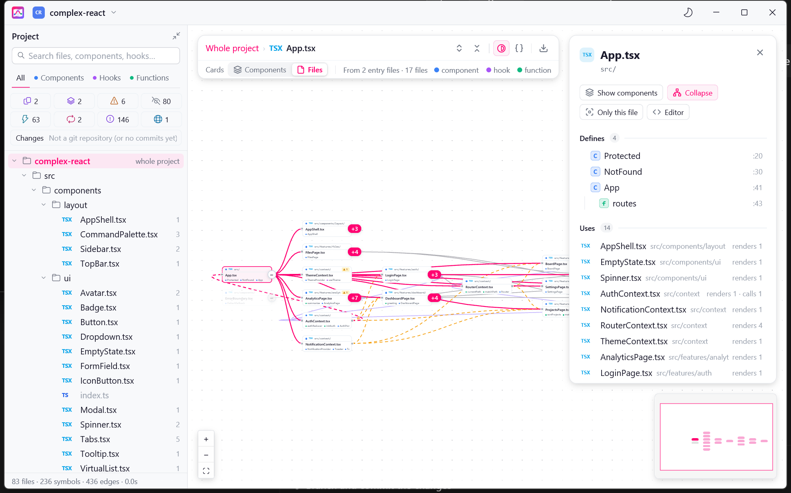
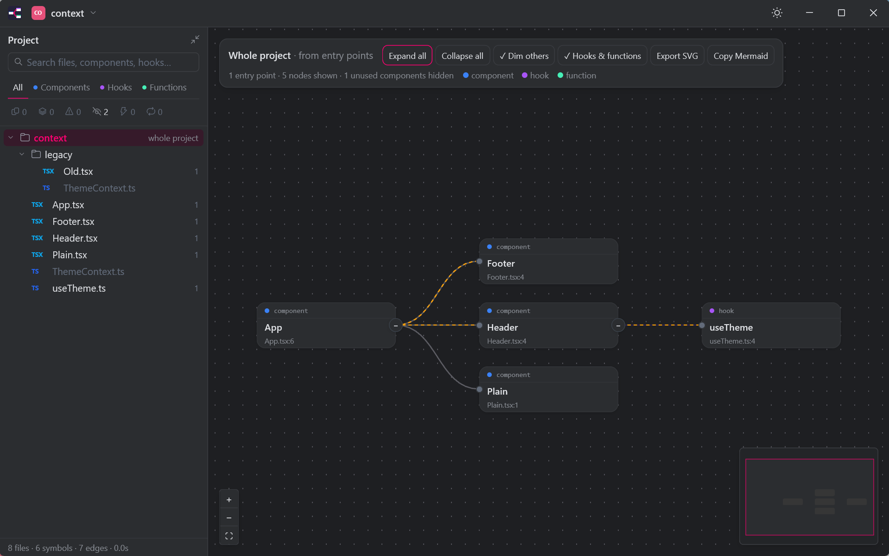
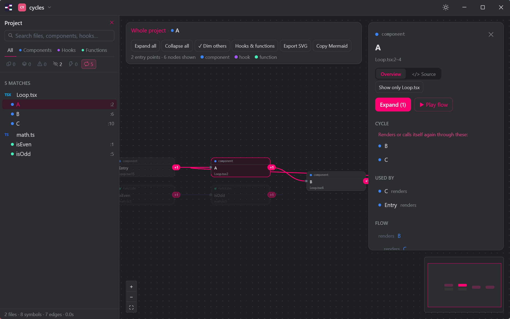
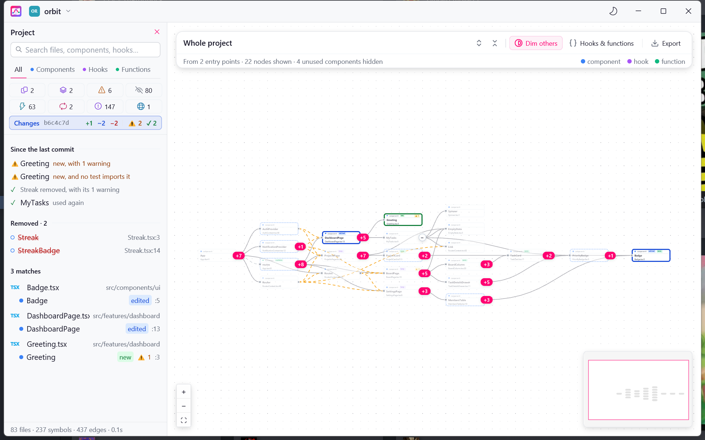
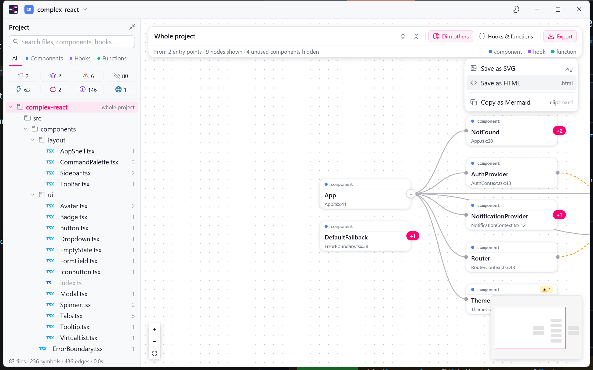

<p align="center">
  
</p>

# Rendermap

### See your React app as a map.

<p>
  <a href="https://github.com/dalladirosa/react-graph/releases/latest"></a>
  <a href="https://github.com/dalladirosa/react-graph/releases/latest"></a>
</p>

[Website](https://dalladirosa.github.io/react-graph/) · [Features](#features) · [Install](#install) · [FAQ](#faq) · [Guides](#guides) · [Build](#build)

[](https://github.com/dalladirosa/react-graph/releases/latest)
[](https://github.com/dalladirosa/react-graph/releases)
[](https://github.com/dalladirosa/react-graph/actions/workflows/ci.yml)


**Free and open source · Windows · macOS (Apple Silicon) · No account needed · Formerly React Graph**

Open a folder of `.ts` / `.tsx` / `.js` / `.jsx` files and Rendermap parses it with tree-sitter. It never runs your code. It shows what renders, calls and passes what, starting from your entry points, with a Project panel inspired by JetBrains IDEs.

## Features

### Components, hooks and functions, as a graph

Everything is a card, with edges for render, call and prop relations. Expand or collapse nodes (one by one, or all at once with the two arrow buttons in the toolbar), use **Dim others** to focus on one, zoom, and pan with the minimap.

### One card per file, if you prefer

The **Cards** switch under the toolbar shows **Files** instead of **Components**: one card per file, with its folder and the symbols it defines, and one link per pair of files, standing for everything one file's symbols render, call or read from the other. Expanding a file card opens the files it uses. Select a file card to see what it defines, the files it uses and the files that use it (with how: "renders 2 · calls 1"); **Show components** goes back to component cards for that file. Filters, warnings, changes since the branch point and Export work on file cards too, and the choice is saved with the project's view.



### Context links

A component that provides a context (`<ThemeContext.Provider>`) is linked, with a dashed amber edge (solid when zoomed far out), to everything that reads it: `useContext(ThemeContext)`, and the components and hooks that call a custom hook doing so.



### Next.js, understood

App Router (`app/`) and Pages Router (`pages/`) projects are recognised. `page`, `layout`, `loading`, `error`, `not-found`, `route` and `_app` files are marked as entry points with their URL (`/blog/[slug]`; route groups and slots don't count), are never reported as unused, and each page and layout hangs off the nearest layout above it. Components get a `server` / `client` badge: Server Components by default, client with `"use client"` or when a client component renders them, and Server Actions with `"use server"`. A Server Component that calls `useState`, `useEffect` and the like, or puts `onClick` on an element, gets a warning.

### Path aliases

`paths` and `baseUrl` from `tsconfig.json` / `jsconfig.json` (including `extends`) are followed, so `import { Button } from "@/ui/Button"` resolves like a relative import. Without a config, `@/` and `~/` are assumed to mean `src/`.

### Live reload

The graph rebuilds when a source file or tsconfig in the open folder changes. Selection, expanded cards and the view stay where they are.

### A Project panel, like an IDE

A file tree with symbol counts. Search by typing anywhere, and use the tabs to show only components, hooks or functions (Ctrl+click, or ⌘-click on a Mac, combines kinds).

### Code-health filters

Each filter shows how many symbols match.

| Filter | What it finds |
| --- | --- |
| **Duplicates** | Similar code exists elsewhere (structural fingerprints, so renamed copies still match). |
| **Identical** | An exact structural twin exists, where only names or literals differ. |
| **Warnings** | Hook dependency problems, memo-defeating props, prop drilling, missing `<Suspense>` or error boundaries, and rule-of-React breaks. See below. |
| **Unused** | Nothing renders, calls or passes it. |
| **Memoized** | Wrapped in `memo`, `useCallback` or `useMemo`. |
| **Cycles** | Components or functions that render or call each other in a loop (A → B → A). Self-recursion doesn't count. |
| **No tests** | No test file imports it. |
| **Data** | Calls out to an API, a data-fetching hook or a store itself. |



**Warnings** cover:

- Hook dependency problems.
- Props that defeat a `memo` child: an inline `{}`, `[]` or `() => …`, or a value built in the render body, passed to a component wrapped in `memo`.
- **Prop drilling:** a prop that two or more components only hand on to a child, without reading it, before something finally uses it. The hint names the whole route.
- `lazy()` components rendered with no `<Suspense>` above them, and route pages with no error boundary (no `errorElement` on the route or its parents, and no `ErrorBoundary` around the page). Components loaded with `lazy(() => import(...))` get a `lazy` badge. A component that renders its `children` inside a `<Suspense>` or an `ErrorBoundary` covers what is passed to it, and a router (`Routes`, `RouterProvider`, `Outlet`) shown inside one covers its pages. A boundary around `render(<App />)`, outside any component, can't be seen.
- Four rules of React: hooks called conditionally, in a loop, in a callback, after an early return or outside a component or hook; effects that add a listener, interval, subscription or WebSocket but return no cleanup; state an effect only derives from other values (compute it while rendering instead); and `.map()` list items without a `key`.

**No tests.** Test files are `*.test.*`, `*.spec.*` and anything in a `__tests__` folder; imports through barrels and path aliases count, and `import * as x` covers the whole file. Only top-level symbols are flagged, and the filter stays empty in a project with no tests. Select a symbol to see the tests that import it under **Tests**, and click one to open it in your editor.

**Data.** Cards get a `data` badge, and the detail panel lists each call with its method and path (`POST /api/orders/{}`), including those made by the hooks and functions the symbol calls ("via useTodos"). Detects `fetch`, `axios.get(...)`, `useQuery`, `useSWR`, `useMutation`, and stores (redux, zustand `use...Store`, jotai, recoil), by well-known names only.

### What changed on your branch

In a git repository, the graph is compared with the commit where your branch split from the default branch (`origin/HEAD`, else `main` or `master`; on that branch itself, HEAD), so commits on the branch count as changes too. New files git ignores are left out.

- New cards get a green border and a `new` badge, edited ones a blue border and an `edited` badge, and unchanged cards that use one of them a dashed blue border (where the change may show).
- A removed symbol is drawn as a faded, dashed red card after the open card that used it, and a link that is gone is drawn as a dashed red line.
- The **Changes** strip under the filters counts new, edited and removed symbols, plus the problems your uncommitted edits brought in (`⚠`) or fixed (`✓`): new or extra warnings, a component nothing uses any more, a new render/call loop, new code no test imports. Click it to show only what changed, with those problems and the removed symbols listed above.
- Select a card to see which links it gained or lost ("now renders Streak", "no longer renders MyTasks").

It updates when you save a file and when you commit or switch branches. Needs the `git` command on your PATH.



### Compare, side by side

Shows two similar symbols side by side, with the differing tokens highlighted.

### Play a flow

Animates a trace from any symbol, either level by level ("waves") or in call-and-return order, and can also show it as a sequence diagram.

### Find the path between two cards

Right-click a card and choose **Find path from here…**, then right-click another card and choose **Find path to here**. The shortest chain of renders and calls between them is drawn, lit up, with everything else faded. If the second card doesn't lead to the first, the other direction is tried. Esc clears it.

### Read the code without leaving

The source view shows the code for the selected symbol or file. Right-click a card and choose **Open in editor** to jump to its line in VS Code (the `code` command must be on your PATH; otherwise the file opens with the system default).

### Share it

The **Export** menu in the toolbar has three choices:

- **Save as SVG** saves what is drawn as a picture.
- **Save as HTML** saves it as one self-contained page (no network, no dependencies) that you can pan, zoom and search. Clicking a card lights up everything it uses and everything that uses it.
- **Copy as Mermaid** puts it on the clipboard as a Mermaid flowchart.



### It remembers where you were

Each project keeps its open cards, filters, selected symbol, picked file and the "Hooks & functions" / "Dim others" switches, and puts them back the next time you open it. Cards that no longer exist are dropped, and renaming or editing code around a symbol doesn't lose it (symbols are matched by file and name, not by line). There are light and dark themes, and a list of recently opened projects.

## Light by design

| Rust | tree-sitter | 0 | 0 |
| :---: | :---: | :---: | :---: |
| Native, GPU-drawn UI | Parses, never runs your code | Accounts | Network calls |

## Your code stays on your computer

- Your source is parsed locally. Nothing is uploaded, and the app has no network code.
- Rendermap only reads your project folder. It never changes it. (The Changes view briefly unpacks the base commit into your system temp folder, then deletes it.) Export writes only where you choose.
- Settings, recent projects and saved views are plain text files on your disk (see [Where settings live](#where-settings-live)).
- Exported HTML pages are self-contained: no network, no dependencies.

## Install

Download the latest build from the [Releases page](https://github.com/dalladirosa/react-graph/releases/latest).

### Windows

| File | What it is |
| --- | --- |
| `rendermap-<version>-setup.exe` | Installer. Adds a Start Menu entry (and an optional desktop shortcut) and an uninstaller. It installs for your user only, without admin rights, unless you choose "all users". |
| `rendermap-<version>-windows-x64-portable.zip` | Portable version: a single `rendermap.exe` you can run from anywhere. |

The builds aren't code-signed yet, so Windows SmartScreen may warn the first time. Click **More info → Run anyway**.

### Mac (Apple Silicon: M1 or later)

Download `rendermap-<version>-macos-arm64.dmg`, open it, and drag **Rendermap** onto **Applications**.

When the repository has the signing secrets (see [Signing the macOS build](#signing-the-macos-build)), release builds are notarized by Apple and open normally. Without them, macOS blocks the app the first time ("Apple could not verify…"). To allow it once, open **System Settings → Privacy & Security** and click **Open Anyway** next to Rendermap, or run this once in Terminal:

```bash
xattr -dr com.apple.quarantine "/Applications/Rendermap.app"
```

## FAQ

**Does it run my app?**
No. It reads the files and parses them with tree-sitter. It never runs your code or your build.

**Does it work with TypeScript, JavaScript, Next.js?**
Yes to all three: `.ts`, `.tsx`, `.js` and `.jsx` files, with App Router and Pages Router recognised.

**Why is a component marked Unused?**
Nothing in the project renders, calls or passes it. Next.js `page`, `layout` and the other route files are never reported as unused, because the framework is the caller.

**Why is the Data filter empty, or missing a call?**
Data calls are detected by well-known names only (`fetch`, `axios`, `useQuery`, `useSWR`, redux, zustand, jotai, recoil). A home-made API client won't be seen.

**Why does the Changes strip say nothing?**
The open folder must be inside a git repository, and the `git` command must be on your PATH.

**Is there a Linux build?**
Not yet. See [Status](#status).

**Windows or macOS says the app is from an unknown publisher.**
See [Install](#install). The Windows builds aren't code-signed, and the Mac build is notarized only when the signing secrets are set.

**It used to be called React Graph.**
Yes. Your settings are moved over the first time Rendermap starts, and the Windows installer upgrades an existing React Graph install in place.

## Guides

### Open a project

Open a folder from the project menu in the title bar (Ctrl+O, or ⌘O on a Mac). You can also pass a folder on the command line:

```bash
rendermap.exe C:\path\to\my-app                                        # Windows
"/Applications/Rendermap.app/Contents/MacOS/rendermap" ~/code/my-app   # macOS
```

`node_modules` and other build folders are skipped.

### Where settings live

Settings (theme and recent projects) are stored in `%APPDATA%\rendermap\settings.txt` on Windows and `~/.config/rendermap/settings.txt` on macOS. Saved views are in `views.txt` next to it. Settings from React Graph (the app's old name, in a `react-graph` folder) are moved over the first time Rendermap starts.

### Filters and the Project panel

Type anywhere to search. Use the **Components**, **Hooks** and **Functions** tabs to narrow the list, and Ctrl+click (⌘-click on a Mac) to combine kinds. Each code-health filter shows its count; see [Code-health filters](#code-health-filters).

### Review a branch

Open the project on your feature branch, then click the **Changes** strip. You see only what your branch added, edited or removed since it split from the default branch, and the problems your uncommitted edits brought in or fixed. See [What changed on your branch](#what-changed-on-your-branch).

### Trace how something runs

Right-click a card to start **Find path from here…**, or use **Play flow** to animate a trace from a symbol. Choose "waves" for level by level, or call-and-return order for a sequence diagram.

## Build

You need [Rust](https://rustup.rs/) (stable, 2024 edition), plus the MSVC build tools on Windows or the Xcode Command Line Tools on macOS.

```bash
cargo run --release -- path/to/my-app
```

| Crate | What it does |
| --- | --- |
| [`gpui`](https://crates.io/crates/gpui) | The GPU-drawn UI. |
| [`tree-sitter`](https://crates.io/crates/tree-sitter), [`tree-sitter-typescript`](https://crates.io/crates/tree-sitter-typescript) | Parses TypeScript, TSX and JavaScript. |
| [`notify`](https://crates.io/crates/notify) | Watches the open folder for live reload. |
| [`walkdir`](https://crates.io/crates/walkdir) | Walks the project folder. |
| [`serde_json`](https://crates.io/crates/serde_json) | Reads `tsconfig.json` and `jsconfig.json`. |

### Testing

Run the tests with `cargo test`. The fixtures in `tests/fixtures` are small React projects, one for each feature (aliases, boundaries, context, cycles, data, drilling, Next.js, and more). CI runs them on Windows and Apple Silicon macOS for every pull request.

### Packages

To build the packages locally:

```bash
cargo build --release
# Windows, with Inno Setup 6 (https://jrsoftware.org/isinfo.php) installed:
iscc /DAppVersion=0.6.0 installer/rendermap.iss   # writes dist/rendermap-0.6.0-setup.exe
# macOS (needs `pip install dmgbuild`):
installer/macos/bundle.sh 0.6.0                     # writes dist/Rendermap.app and dist/rendermap-0.6.0-macos-arm64.dmg
```

### Releasing

Releases are built by [`.github/workflows/release.yml`](.github/workflows/release.yml):

1. Bump `version` in `Cargo.toml` (for example `0.2.1`) and commit.
2. Tag the commit and push the tag:
   ```bash
   git tag v0.2.1
   git push origin v0.2.1
   ```
3. The workflow builds the Windows installer and portable zip, and the macOS `.dmg` on an Apple Silicon machine. It then publishes them together in one GitHub Release with automatic release notes.

The tag must match the `Cargo.toml` version, or the workflow stops. You can also start the workflow by hand from the **Actions** tab. That builds everything and attaches it to the run, along with a screenshot of the Mac app starting up, but doesn't publish a release.

### Signing the macOS build

To make the `.dmg` open without the "Open Anyway" step, add these repository secrets (Settings → Secrets and variables → Actions). They need a paid Apple Developer account. Without them the build is still made, but only ad-hoc signed.

| Secret | Value |
|--------|-------|
| `MACOS_CERT_P12` | Your "Developer ID Application" certificate and key, exported as `.p12`, then `base64 -i cert.p12 \| pbcopy` |
| `MACOS_CERT_PASSWORD` | The password you set when you exported the `.p12` |
| `APPLE_ID` | The Apple ID email of the developer account |
| `APPLE_TEAM_ID` | Your 10-character team ID (developer.apple.com → Membership) |
| `APPLE_APP_PASSWORD` | An app-specific password from account.apple.com |

The install window's background is `installer/macos/dmg-background*.png`. To change it, edit and run `installer/macos/make_dmg_background.py` (needs Pillow).

## Status

Rendermap is young and moving fast. It runs on Windows and macOS (Apple Silicon). There is no Linux or Intel Mac build yet. Rendermap finds hooks, components and calls by reading syntax, so dynamic code (a component picked by a string at run time, for example) can't be followed. Bug reports and ideas are welcome on the [issues page](https://github.com/dalladirosa/react-graph/issues).

## Credits

- The macOS icons come from [Lucide](https://lucide.dev) (ISC license; see [`assets/icons/LICENSE`](assets/icons/LICENSE)).
- UI by [GPUI](https://www.gpui.rs), from the Zed team.
- Parsing by [tree-sitter](https://tree-sitter.github.io).
